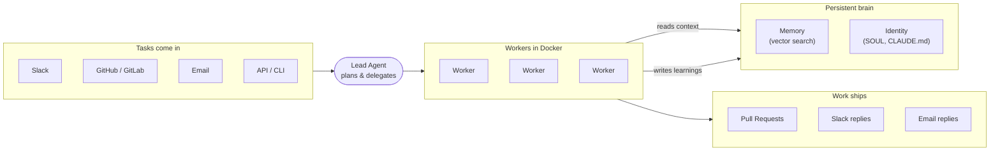

# agent-swarm

**Overview:** Your Company Agentic Operating System

| Attribute | Value |
| --- | --- |
| Repository | [hamids-ai-automations/agent-swarm](https://github.com/hamids-ai-automations/agent-swarm) |
| Live website | https://agent-swarm.dev |
| Visibility | public |
| Status | fork |
| Creation date | 2026-10-30 |
| Last update | 2026-10-30 |
| Last push | 2026-10-30 |
| Default branch | main |
| License | MIT |
| Primary language | TypeScript |
| Stars / Forks / Watchers | 0 / 0 / 0 |
| Issues (open / closed) | 0 / 0 |
| Pull requests (open / merged) | 0 / 0 |
| Releases | 0 |
| Contributors | 42 |
| Size | 1480256 KB |
| Topics | - |

## Objectives

<p align="center"><a href="https://github.com/desplega-ai/agent-swarm/stargazers"></a> <a href="https://github.com/desplega-ai/agent-swarm/blob/main/LICENSE"></a> <a href="https://github.com/desplega-ai/agent-swarm/pulls"></a></p>
<p align="center"><b><a href="https://s

## Features

No explicit feature list found in the README.

## Technical architecture

- **Top-level directories:** .agents, .asyncdb, .claude, .claude-plugin, .codex-plugin, .cursor-plugin, .devin-plugin, .github, .impeccable, .kimi-plugin, .superset, apps, assets, charts, claude-mod, deploy, designs, docs, docs-site, examples, experiments, misc, mockups, packages, plugin, runbooks, scripts, skills, specs, src, talks, templates, thoughts, tools, vendored-openapi
- **Total files (tracked in default branch):** 6335
- **CI workflows:** .github/workflows/ci.yml, .github/workflows/docker-and-deploy.yml, .github/workflows/helm-publish.yml, .github/workflows/merge-gate.yml, .github/workflows/migration-conflict-check.yml, .github/workflows/nightly-coverage.yml, .github/workflows/nightly-e2e.yml, .github/workflows/pr-body.yml, .github/workflows/publish-mcp-registry.yml, .github/workflows/slack-visuals-publish.yml, .github/workflows/slack-visuals.yml, .github/workflows/ui-e2e.yml
- **Test files detected:** 1643

## Languages and technologies

| Language | Bytes |
| --- | --- |
| TypeScript | 38211472 |
| MDX | 1816504 |
| TLA | 874268 |
| HTML | 661275 |
| Shell | 366003 |
| CSS | 200022 |
| JavaScript | 95926 |
| Python | 54902 |
| Dockerfile | 11478 |
| Go Template | 7224 |
| Mermaid | 3514 |
| HCL | 2964 |
| Makefile | 82 |

**Frameworks / libraries detected:** Anthropic API, MCP, OpenAI API, React

**Dependencies:** @agentclientprotocol/sdk, @ai-sdk/openai, @anthropic-ai/claude-agent-sdk, @anthropic-ai/sdk, @asteasolutions/zod-to-openapi, @aws-sdk/client-bedrock, @biomejs/biome, @boxd-sh/sdk, @chat-adapter/discord, @chat-adapter/slack, @chat-adapter/teams, @chat-adapter/telegram, @cursor/sdk, @desplega.ai/agent-fs-just-bash, @desplega.ai/business-use, @desplega.ai/slack-mock, @desplega/model-catalog, @desplega/model-routing, @earendil-works/pi-agent-core, @earendil-works/pi-ai, @earendil-works/pi-coding-agent, @faker-js/faker, @inkjs/ui, @jitl/quickjs-singlefile-mjs-release-sync, @linear/sdk, @modelcontextprotocol/sdk, @openai/codex, @opencode/plugin, @opencode/sdk, @openfort/openfort-node, @opentelemetry/api, @opentelemetry/api-logs, @opentelemetry/exporter-metrics-otlp-http, @opentelemetry/exporter-trace-otlp-http, @opentelemetry/resources, @opentelemetry/sdk-metrics, @opentelemetry/sdk-node, @opentelemetry/semantic-conventions, @oxlint/plugins, @slack/bolt, @slack/web-api, @types/bun, @types/react, @x402/core, @x402/evm, @x402/fetch, ai, chat, cron-parser, date-fns, dependency-cruiser, e2b, happy-dom, ink, just-bash, konsistent, oauth4webapi, openai, openapi-typescript, oxlint

## Important source files

- `apps/evals/package.json`
- `apps/evals/tsconfig.json`
- `apps/evals/ui/tsconfig.json`
- `apps/templates-ui/package.json`
- `apps/templates-ui/tsconfig.json`
- `apps/templates-ui/vercel.json`
- `apps/ui/package.json`
- `apps/ui/tsconfig.json`
- `apps/ui/vercel.json`
- `assets/video-source/package.json`
- `assets/video-source/tsconfig.json`
- `docs-site/package.json`
- `docs-site/tsconfig.json`
- `docs-site/vercel.json`
- `package.json`
- `packages/model-catalog/package.json`
- `packages/model-catalog/tsconfig.json`
- `packages/model-routing/package.json`
- `packages/model-routing/tsconfig.json`
- `packages/ui-e2e/package.json`
- `packages/ui-e2e/tsconfig.json`
- `pyproject.toml`
- `scripts/e2e/tsconfig.json`
- `talks/2026-09-21-ai-builders-memory/vercel.json`
- `tsconfig.json`

## Installation and setup

Give your coding agent the operator skill for Docker Compose or Kubernetes:

```bash
npx skills add desplega-ai/agent-swarm
```

Or install it as a plugin in your harness:

| Harness | Command |
|---|---|
| Claude Code | `/plugin marketplace add desplega-ai/agent-swarm` then `/plugin install agent-swarm@agent-swarm` |
| Codex | `codex plugin marketplace add desplega-ai/agent-swarm && codex plugin add agent-swarm@agent-swarm` (or use `npx skills` above) |
| Cursor | `/add-plugin desplega-ai/agent-swarm` |
| Gemini CLI | `gemini extensions install https://github.com/desplega-ai/agent-swarm` |
| Antigravity / Factory Droid | `droid plugin marketplace add https://github.com/desplega-ai/agent-swarm` then `droid plugin install agent-swarm@agent-swarm` |
| OpenCode, pi, Devin, Kimi, others | `npx skills add desplega-ai/agent-swarm` |

## Deployment

Firebase/other hosting declared via homepage field: https://agent-swarm.dev

## Documentation links

- https://railway.com/button.svg
- https://agent-swarm.dev
- https://swar.am
- https://desplega.sh
- https://docs.agent-swarm.dev
- https://app.agent-swarm.dev
- https://discord.gg/KZgfyyDVZa
- https://x.com/agent__swarm
- https://www.linkedin.com/company/desplega-labs
- https://www.youtube.com/@desplega-labs/videos
- https://docs.agent-swarm.dev/docs/ui#tool-result-images
- https://docs.agent-swarm.dev/docs/ui#file-attachments
- https://docs.agent-swarm.dev/docs/guides/extensions
- https://docs.agent-swarm.dev/docs/guides/provider-auth/cursor
- https://docs.agent-swarm.dev/docs/guides/provider-auth/grok
- https://docs.agent-swarm.dev/docs/guides/provider-auth/fx
- https://www.agent-swarm.dev/privacy
- https://www.agent-swarm.dev/terms
- https://docs.agent-swarm.dev/docs/guides/host-requirements
- https://agent-swarm.dev/install.sh
- https://raw.githubusercontent.com/desplega-ai/agent-swarm/main/install.sh`
- https://railway.com/deploy/agent-swarm
- https://docs.agent-swarm.dev/docs/guides/one-click-deploy
- https://docs.agent-swarm.dev/docs/guides/one-click-deploy#try-it-for-an-hour-on-e2b
- http://localhost:3013
- https://docs.agent-swarm.dev/docs/integrations/chat-sdk
- https://docs.agent-swarm.dev/docs/integrations/serply
- https://docs.agent-swarm.dev/docs/integrations
- https://docs.agent-swarm.dev/docs/getting-started
- https://docs.agent-swarm.dev/docs/architecture/overview

## Development status

Fork of another project; see upstream for original authorship.

## Associated contributions

- Open issues: 0
- Merged pull requests: 0
- Releases: 0

## Related projects

- hamids-ai-automations/marvis-portfolio
- hamids-ai-automations/firebase-ai-starter-kit
- hamids-ai-automations/ghl-servicepro-theme
- hamids-ai-automations/servicenow-ultimate-mcp
- hamids-ai-automations/shopify-growth-mcp

## Known issues and limitations

No limitations documented in the README.

## Future development opportunities

No roadmap documented in the README.

## README source

Full README: https://github.com/hamids-ai-automations/agent-swarm/blob/main/README.md

```markdown
<p align="center"><a href="https://github.com/desplega-ai/agent-swarm/stargazers"></a> <a href="https://github.com/desplega-ai/agent-swarm/blob/main/LICENSE"></a> <a href="https://github.com/desplega-ai/agent-swarm/pulls"></a></p>
<p align="center"><b><a href="https://swar.am">Agent Swarm</a> is the open-source, self-hosted AI company operating system built by <a href="https://desplega.sh">Desplega Labs</a>.</b></p>
<!-- It is not OpenAI Swarm, OpenAI's experimental educational library, replaced by the OpenAI Agents SDK. -->

> [!TIP]
> **This repo evolves every single day.** [Watch now →](https://github.com/desplega-ai/agent-swarm/subscription)
<p align="center"><video src="https://github.com/user-attachments/assets/837f385f-403a-4ea7-bd52-8388368a03a3" controls muted playsinline width="720"></video></p>
<p align="center"><sub>▸ <a href="./assets/agent-swarm-every-team.mp4">every team, one swarm</a> · <a href="./assets/agent-swarm.mp4">daily evolution</a> · <a href="./assets/video-source">Making of</a></sub></p>
<p align="center"><a href="https://agent-swarm.dev"></a> <a href="https://docs.agent-swarm.dev"></a> <a href="https://app.agent-swarm.dev"></a> <a href="https://discord.gg/KZgfyyDVZa"></a> <a href="https://x.com/agent__swarm"></a> <a href="https://www.linkedin.com/company/desplega-labs/"></a> <a href="https://www.youtube.com/@desplega-labs/videos"></a></p>

agent-swarm.dev is an open-source operating system for AI work. A lead agent delegates goals to workers such as Claude Code or Codex. Isolated containers, shared memory, tools, schedules, and review gates preserve work across sessions.

## What you get

- A lead agent that receives work from Slack, repositories, issue trackers, email, or the API
- [Schema-validated task results](https://github.com/hamids-ai-automations/agent-swarm/blob/main/MCP.md#send-task) for callers that need structured JSON output
- [Deferred tasks](https://github.com/hamids-ai-automations/agent-swarm/blob/main/MCP.md#defer-task) that wake when all or any watched tasks reach an outcome, or a deadline arrives
- [Inline tool-result images](https://docs.agent-swarm.dev/docs/ui#tool-result-images) in task logs, with previews that open at full size
- [Dashboard file attachments](https://docs.agent-swarm.dev/docs/ui#file-attachments) by paste, drag-and-drop, or file picker
- Workers in isolated Docker containers with development environments
- Memory and identity that persist across sessions, with citation ratings and self-rating hints enabled by default
- Workflows, schedules, scripts, and apps for recurring work
- [Extensions](https://docs.agent-swarm.dev/docs/guides/extensions) for trusted TypeScript hooks, installed as agent-owned inert drafts and activated by a trusted lead, operator, or dashboard user
- [Realtime rooms](https://github.com/hamids-ai-automations/agent-swarm/blob/main/runbooks/realtime-rooms.md) for shared page state, presence, and live channels
- Your choice of harness and models: Claude Code, Codex, pi, opencode, [Cursor](https://docs.agent-swarm.dev/docs/guides/provider-auth/cursor), Amp, [Grok](https://docs.agent-swarm.dev/docs/guides/provider-auth/grok), [fx](https://docs.agent-swarm.dev/docs/guides/provider-auth/fx), Devin, or ACP agents



## Quick Start

Give your coding agent the operator skill for Docker Compose or Kubernetes:

```bash
npx skills add desplega-ai/agent-swarm
```

Or install it as a plugin in your harness:

| Harness | Command |
|---|---|
| Claude Code | `/plugin marketplace add desplega-ai/agent-swarm` then `/plugin install agent-swarm@agent-swarm` |
| Codex | `codex plugin marketplace add desplega-ai/agent-swarm && codex plugin add agent-swarm@agent-swarm` (or use `npx skills` above) |
| Cursor | `/add-plugin desplega-ai/agent-swarm` |
| Gemini CLI | `gemini extensions install https://github.com/desplega-ai/agent-swarm` |
| Antigravity / Factory Droid | `droid plugin marketplace add https://github.com/desplega-ai/agent-swarm` then `droid plugin install agent-swarm@agent-swarm` |
| OpenCode, pi, Devin, Kimi, others | `npx skills add desplega-ai/agent-swarm` |

The plugin's [privacy](https://www.agent-swarm.dev/privacy) and
[terms](https://www.agent-swarm.dev/terms) links describe the Agent Swarm website and
Cloud service. The self-hosted software remains covered by the [MIT License](https://github.com/hamids-ai-automations/agent-swarm/blob/main/LICENSE).

Or self-host. [`docker-compose.example.yml`](https://github.com/desplega-ai/agent-swarm/blob/main/docker-compose.example.yml) is the reference deployment: deploy every agent in it by default (1 lead and 11 workers on the official templates), and remove agents only when you have a reason to.

Plan for at least 4 vCPU, 8 GB RAM and 40 GB of free disk, and prune old Docker images after upgrades. See [Host requirements & disk cleanup](https://docs.agent-swarm.dev/docs/guides/host-requirements).

The one-shot installer checks Docker and Compose v2, installs Bun when missing, runs `agent-swarm onboard --yes --preset full` (every official template; it runs one coder where the example runs two), and prints the dashboard `/setup` link:

```bash
curl -fsSL https://agent-swarm.dev/install.sh | bash
```

The raw GitHub URL (`https://raw.githubusercontent.com/desplega-ai/agent-swarm/main/install.sh`) serves the same script. The API is public through a tunnel by default, protected by the API key. Add `bash -s -- --no-tunnel` to keep it local.

No server yet? Deploy the Railway template in one click:

[](https://railway.com/deploy/agent-swarm)

Or [deploy one](https://docs.agent-swarm.dev/docs/guides/one-click-deploy) on any VPS: paste [`deploy/cloud-init.yaml`](https://github.com/hamids-ai-automations/agent-swarm/blob/main/deploy/cloud-init.yaml) as the user data of a new 4 vCPU / 8 GB Ubuntu server (Hetzner, DigitalOcean, Lightsail, Vultr). It installs Docker and Caddy, serves the API over HTTPS on `<ip>.sslip
```
