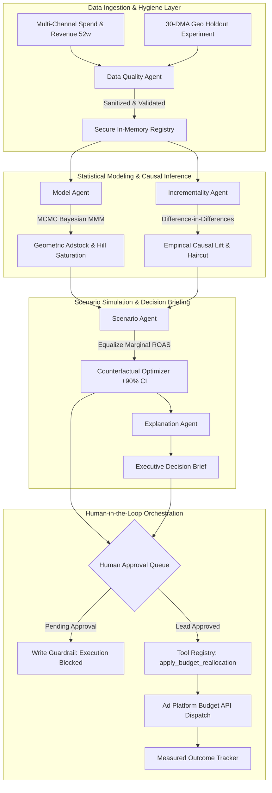

# ai-marketing-mix-copilot

**Overview:** Production-grade Bayesian Marketing Mix Modeling (MMM) & Causal Incrementality Copilot with Multi-Agent Orchestration and Human-in-the-Loop Governance.

| Attribute | Value |
| --- | --- |
| Repository | [hamids-ai-automations/ai-marketing-mix-copilot](https://github.com/hamids-ai-automations/ai-marketing-mix-copilot) |
| Live website | https://marvis.web.app/ |
| Visibility | public |
| Status | active |
| Creation date | 2026-10-12 |
| Last update | 2026-11-20 |
| Last push | 2026-10-12 |
| Default branch | main |
| License | MIT |
| Primary language | Python |
| Stars / Forks / Watchers | 1 / 0 / 0 |
| Issues (open / closed) | 0 / 0 |
| Pull requests (open / merged) | 0 / 0 |
| Releases | 0 |
| Contributors | 1 |
| Size | 636 KB |
| Topics | adtech, ai-marketing, bayesian-mmm, budget-allocation, causal-inference, incrementality, marketing-analytics, marketing-mix-modeling, martech, mmm, multi-agent, python, roi-optimization, ai-agents, llm |

## Objectives

# AI Marketing Mix & Incrementality Copilot 📈

## Features

No explicit feature list found in the README.

## Technical architecture

- **Top-level directories:** .github, agents, backend, data, docs, evaluation, frontend, infra, modeling, tools
- **Total files (tracked in default branch):** 66
- **CI workflows:** .github/workflows/ci.yml
- **Test files detected:** 10

## Languages and technologies

| Language | Bytes |
| --- | --- |
| Python | 116685 |
| HTML | 26665 |
| Dockerfile | 585 |

**Frameworks / libraries detected:** FastAPI, NumPy, SQLAlchemy, pandas, pytest

**Dependencies:** fastapi, numpy, pandas, pydantic, pytest, python-multipart, scipy, sqlalchemy, uvicorn

## Important source files

- `backend/app/main.py`
- `docker-compose.yml`
- `requirements.txt`

## Installation and setup

No installation instructions found in the README.

## Deployment

Firebase/other hosting declared via homepage field: https://marvis.web.app/

## Documentation links

- https://marvis.web.app
- https://www.python.org/downloads
- http://localhost:8000
- http://localhost:8000/docs

## Development status

Active — last push 2026-10-12

## Associated contributions

- Open issues: 0
- Merged pull requests: 0
- Releases: 0

## Related projects

- hamids-ai-automations/agentshield-ai
- hamids-ai-automations/seo-intelligence-ai
- hamids-ai-automations/adwaste-intelligence
- hamids-ai-automations/github-profile-master-record
- hamids-ai-automations/leadflow-sentinel

## Known issues and limitations

No limitations documented in the README.

## Future development opportunities

No roadmap documented in the README.

## README source

Full README: https://github.com/hamids-ai-automations/ai-marketing-mix-copilot/blob/main/README.md

```markdown
# AI Marketing Mix & Incrementality Copilot 📈

[](https://github.com/hamid-digitalmarketer/ai-marketing-mix-copilot/actions/workflows/ci.yml)
[](https://www.python.org/downloads/)
[](LICENSE)
[](evaluation/tests/)
[](evaluation/eval_runner.py)
[](#zero-cost-local-execution)
[](https://github.com/hamid-digitalmarketer/ai-marketing-growth-os)

An enterprise-grade, open-source **Bayesian Marketing Mix Modeling (MMM)** and **Causal Incrementality Copilot**. Built with multi-agent orchestration, the platform isolates true incremental returns (iROAS), models Hill diminishing returns saturation curves, simulates counterfactual budget reallocations with 90% Bayesian credible intervals, and enforces rigorous **Human-in-the-Loop** governance before executing portfolio media changes.

---

## 📌 Executive Overview: The Problem with Modern Marketing Attribution

Modern digital marketing attribution is fundamentally broken:
1. **The Last-Touch Attribution Illusion**: Ad platform dashboards (Google Ads, Meta Ads) credit 100% of purchase value to the last click or impression. In reality, **over 60% of brand search conversions would have occurred organically**. Platforms take credit for demand they did not generate.
2. **Channel Saturation Blindspots**: Blended ROAS averages out past returns, concealing that a channel is operating past its point of diminishing returns. Marketers continue pouring capital into Google Search ($0.78 marginal return per dollar) while starving high-potential channels like Retail Media ($2.65 marginal return).
3. **Disconnected Experimentation**: Geo-holdout tests and switchback experiments are historically isolated in ad-hoc Jupyter notebooks, never reconciling into unified portfolio budgeting systems.

### Strategic Positioning: How This Complements Tactical Tools
This platform serves as the **strategic companion** to [ai-marketing-growth-os](https://github.com/hamid-digitalmarketer/ai-marketing-growth-os):
- **`ai-marketing-growth-os`**: Operates at the **tactical campaign layer** (campaign audits, creative fatigue detection, keyword expansion, search query sanitization).
- **`ai-marketing-mix-copilot`**: Operates at the **strategic portfolio capital layer** (cross-channel media mix allocation, Bayesian econometrics, empirical geo-holdout causal lift, counterfactual revenue forecasting).

Together, they form a closed-loop marketing intelligence stack that audits tactical ad accounts, measures true causal incrementality, guides capital to where the next dollar earns the highest return, and verifies business outcomes over time.

---

## 🏛️ System Architecture



---

## 📐 Mathematical & Econometric Foundations

The platform's analytical engine implements production-grade Bayesian econometrics and causal inference:

### 1. Geometric Adstock Carryover
Advertising impact decays across subsequent periods following an exponential decay parameter $\alpha \in [0, 1)$:
$$x_{t}^* = x_t + \alpha \cdot x_{t-1}^*$$
Where:
- $x_t$ is the raw spend in week $t$.
- $x_t^*$ is the cumulative adstocked media pressure.
- $\alpha$ is the decay parameter (e.g., $\alpha = 0.65$ for YouTube brand campaigns vs. $\alpha = 0.25$ for direct response search).

### 2. Hill Saturation Function (Diminishing Marginal Returns)
Media response follows an S-shaped Hill function parameterizing maximum potential revenue ($K$) and curve slope ($S$):
$$S(x^*) = \frac{(x^*)^S}{(x^*)^S + K^S}$$
Marginal ROAS (mROI) is computed as the first derivative of the revenue response curve with respect to spend:
$$\text{mROI}(x^*) = \frac{d\,\text{Revenue}}{d\,x^*}$$
- When $\text{mROI} < 1.00$, every additional dollar invested costs more than it returns (**Channel Saturation**).
- When $\text{mROI} > 2.00$, the channel has significant headroom to absorb capital (**Under-allocated Opportunity**).

### 3. Difference-in-Differences Causal Lift Estimator
To verify true incremental impact against last-touch reporting, empirical geo-holdout experiments are evaluated using Difference-in-Differences (DiD):
$$\hat{\tau}_{DiD} = \left(\bar{Y}_{T,\text{post}} - \bar{Y}_{T,\text{pre}}\right) - \left(\bar{Y}_{C,\text{post}} - \bar{Y}_{C,\text{pre}}\right)$$
Attribution haircut calculation:
$$\text{Haircut} = \frac{\text{iROAS}_{\text{causal}} - \text{ROAS}_{\text{reported}}}{\text{ROAS}_{\text{reported}}} = \frac{1.45 - 3.80}{3.80} = -61.8\%$$

---

## 🤖 The 5 Specialized AI Agents

Each agent has a strictly bounded toolset, least-privilege permissions, and Pydantic-validated output contracts:

| Agent | Core Responsibilities | Registered Tools | Permission Scope |
| :--- | :--- | :--- | :--- |
| **Data Quality Agent** | Audits time-series schemas, aligns calendar weeks, imputes zero-variance gaps, detects anomalies, sanitizes text against prompt injections. | `load_raw_data`, `validate_schema`, `detect_missing_values`, `flag_anomalies`, `summarize_data_quality` | `READ_ONLY` |
| **Model Agent** | Decomposes multi-channel revenues, evaluates MCMC chains ($\hat{R} \le 1.018$, $\text{ESS} = 2,450$), calculates adstock carryover, maps Hill curves, and isolates channel mROI. | `fit_bayesian_mmm`, `check_convergence`, `run_diagnostics`, `compute_roi`, `compute_marginal_roi`, `generate_saturation_curves` | `READ_ONLY` |
| **Incrementality Agent** | Analyzes 30-DMA geo holdout experiments, computes synthetic counterfactuals, verifies two-sample t-statistic significance ($p < 0.001$), and determines platform attribution overstatement. | `design_geo_holdout`, `analyze_geo_holdout`, `run_diff_in_diff`, `calculate_lift`, `assess_statistical_significance` | `READ_ONLY` |
| **Scenario Agent** | Solves for the optimal media allocation by equalizing marginal returns across channels; simulates counterfactual spend shifts with 90% Bayesian credible intervals. | `define_budget_scenario`, `simulate_budget_reallocation`, `forecast_outcomes`, `compute_uncertainty_intervals`, `optimize_allocation` | `READ_ONLY` |
| **Explanation Agent** | Translates complex econometric parameters into plain-language executive decision briefs for CMOs 
```
