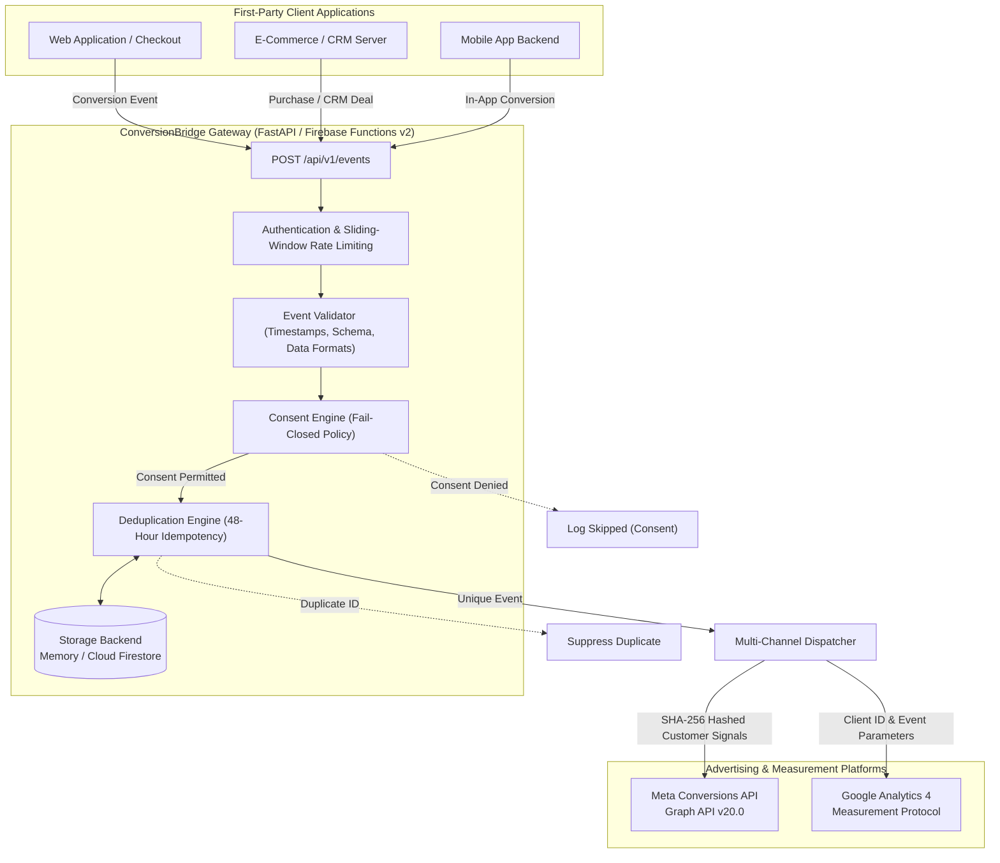

# conversionbridge

**Overview:** Server-side conversion gateway for Meta Conversions API and Google Analytics 4 with privacy controls. Python, Firebase.

| Attribute | Value |
| --- | --- |
| Repository | [hamids-ai-automations/conversionbridge](https://github.com/hamids-ai-automations/conversionbridge) |
| Live website | https://marvis.web.app/ |
| Visibility | public |
| Status | active |
| Creation date | 2026-10-19 |
| Last update | 2026-11-20 |
| Last push | 2026-10-19 |
| Default branch | main |
| License | MIT |
| Primary language | Python |
| Stars / Forks / Watchers | 0 / 0 / 0 |
| Issues (open / closed) | 0 / 0 |
| Pull requests (open / merged) | 0 / 0 |
| Releases | 1 |
| Contributors | 1 |
| Size | 58 KB |
| Topics | attribution, conversion-tracking, firebase-functions, ga4, google-analytics-4, marketing-technology, meta-conversions-api, privacy, python, rest-api, server-side-tracking |

## Objectives

# ConversionBridge

## Features

No explicit feature list found in the README.

## Technical architecture

- **Top-level directories:** .github, app, docs, examples, tests
- **Total files (tracked in default branch):** 62
- **CI workflows:** .github/workflows/ci.yml
- **Test files detected:** 8

## Languages and technologies

| Language | Bytes |
| --- | --- |
| Python | 94204 |

**Frameworks / libraries detected:** FastAPI, Firebase, pytest

**Dependencies:** fastapi, firebase-admin, firebase-functions, google-cloud-firestore, httpx, pydantic, pydantic-settings, python-multipart, uvicorn

## Important source files

- `app/main.py`
- `firebase.json`
- `requirements.txt`

## Installation and setup

No installation instructions found in the README.

## Deployment

Firebase/other hosting declared via homepage field: https://marvis.web.app/

## Documentation links

- https://marvis.web.app
- https://wa.me/923167417135
- http://localhost:8080/docs`
- http://localhost:8080/api/v1/events
- https://example.com/consultation

## Development status

Active — last push 2026-10-19

## Associated contributions

- Open issues: 0
- Merged pull requests: 0
- Releases: 1

## Related projects

- hamids-ai-automations/marvis-streamlit-dashboard
- hamids-ai-automations/github-profile-master-record
- hamids-ai-automations/agentshield-ai
- hamids-ai-automations/seo-intelligence-ai
- hamids-ai-automations/adwaste-intelligence

## Known issues and limitations

No limitations documented in the README.

## Future development opportunities

No roadmap documented in the README.

## README source

Full README: https://github.com/hamids-ai-automations/conversionbridge/blob/main/README.md

```markdown
# ConversionBridge

<p align="center">
  <b>Privacy-First Server-Side Conversion Tracking for Meta Ads & Google Analytics 4.</b>
</p>

<p align="center">
  <a href="https://github.com/hamid-digitalmarketer/conversionbridge/actions"></a>
  
  
  
  <a href="LICENSE"></a>
  <a href="https://wa.me/923167417135"></a>
</p>

---

## 📌 Executive Summary

**ConversionBridge** is an enterprise-grade, open-source Python and Firebase solution for capturing consent-aware first-party conversion events and dispatching them directly to **Meta Conversions API (CAPI)** and **Google Analytics 4 (GA4) Measurement Protocol** via server-to-server integrations.

Modern performance marketing suffers from severe signal degradation caused by iOS App Tracking Transparency (ATT), browser ad-blockers, ITP cookie lifespan caps, and third-party cookie restrictions. Browser-only tracking routinely misses **15% to 30% of conversions**, distorting return on ad spend (ROAS) and crippling algorithmic bidding.

ConversionBridge restores measurement integrity by moving conversion delivery to a trusted, secure first-party server environment—enforcing user consent, eliminating duplicate transactions, and protecting customer privacy.

---

## 🏗️ System Architecture



---

## ✨ Key Capabilities

- **Unified Multi-Channel Gateway**: Ingests a single standardized first-party event and dispatches to Meta CAPI, GA4, or both in parallel.
- **Fail-Closed Consent Architecture**: Gated by explicit consent flags (`consent.advertising` for Meta, `consent.analytics` for GA4). If consent is missing or rejected, events are safely suppressed.
- **Cryptographic PII Protection**: Automatically normalizes and generates one-way SHA-256 hashes for customer emails, phone numbers, and physical addresses per platform specifications. Unhashed technical context (`_fbp`, `_fbc`, IP, User-Agent) is preserved.
- **Cross-Channel Deduplication**: Supports a 48-hour deduplication window using isolated storage keys (`meta:Lead:1001` vs `ga4:Lead:1001`) to prevent duplicate retries while preserving independent delivery.
- **Dual Runtime Support**: Operates as a native ASGI application (FastAPI / Uvicorn) for Docker/Cloud Run and as an HTTP Cloud Function on **Firebase Cloud Functions for Python (v2)**.
- **Dry-Run Test Endpoint**: Dedicated `POST /api/v1/events/test` route validates schemas, simulates consent rules, and generates safe wire-format previews without transmitting live advertising data.
- **Built-in Security Defenses**: API key/Bearer token protection, sliding-window rate limiting (120 req/min), body size limits (512 KB), and automated secret redaction in logs.

---

## 🛠️ Technology Stack

| Layer | Technologies |
|---|---|
| **Backend Framework** | Python 3.11 / 3.12, FastAPI, Pydantic v2, Pydantic-Settings |
| **Serverless Runtime** | Firebase Cloud Functions for Python (v2), Google Cloud Functions |
| **HTTP Client** | HTTPX (Asynchronous, connection pooling, timeout controls) |
| **Persistence & State** | Google Cloud Firestore (Distributed Serverless), In-Memory (Dev/Test) |
| **Quality & Testing** | Pytest, Pytest-Asyncio, Ruff (Linter & Formatter), MyPy |
| **CI / DevOps** | GitHub Actions CI, Firebase CLI, Google Secret Manager |

---

## 📦 Directory Structure

```
conversionbridge/
├── app/
│   ├── __init__.py
│   ├── main.py                  # FastAPI app & Firebase Functions v2 handler
│   ├── config.py                # Pydantic Settings configuration
│   ├── routes/
│   │   ├── events.py            # POST /api/v1/events & POST /api/v1/events/test
│   │   ├── health.py            # GET /health
│   │   └── status.py            # GET /api/v1/destinations/status
│   ├── schemas/
│   │   └── events.py            # Pydantic data models & validators
│   ├── services/
│   │   ├── event_processor.py   # Multi-destination dispatcher coordinator
│   │   ├── consent.py           # Privacy & consent evaluation engine
│   │   ├── deduplication.py     # Cross-channel deduplication service
│   │   └── validation.py        # Deep schema & integrity validator
│   ├── destinations/
│   │   ├── base.py              # BaseDestination abstract interface
│   │   ├── meta.py              # Meta Conversions API adapter
│   │   └── ga4.py               # GA4 Measurement Protocol adapter
│   ├── security/
│   │   ├── authentication.py    # API Key & Bearer token verification
│   │   ├── rate_limit.py        # Sliding-window rate limiter
│   │   └── secrets.py           # Secret masking & SHA-256 hashing
│   └── storage/
│       ├── base.py              # StorageBackend abstract interface
│       ├── memory.py            # Thread-safe in-memory cache
│       └── firestore.py         # Google Cloud Firestore transactional storage
├── tests/
│   ├── test_events.py           # API routes & validation tests
│   ├── test_consent.py          # Consent engine & privacy tests
│   ├── test_deduplication.py    # Deduplication & TTL window tests
│   ├── test_meta.py             # Meta CAPI adapter tests
│   ├── test_ga4.py              # GA4 adapter & debug mode tests
│   └── test_security.py         # Auth, rate limiting & secret redaction
├── examples/
│   ├── python_client.py         # Python backend integration script
│   ├── javascript_client.js     # Browser / Node.js integration script
│   ├── sample_event.json        # Standard sample payload
│   ├── sample_lead_event.json   # B2B lead generation payload
│   └── sample_purchase_event.json # E-commerce transaction payload
├── docs/
│   ├── architecture.md          # Detailed subsystem architecture
│   ├── meta-setup.md            # Meta Business Manager & token setup
│   ├── ga4-setup.md             # GA4 Data Stream & API secret setup
│   ├── d
```
