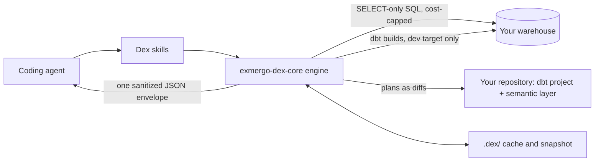

# dex

**Overview:** Dex lets your agent build your analytics.

| Attribute | Value |
| --- | --- |
| Repository | [hamids-ai-automations/dex](https://github.com/hamids-ai-automations/dex) |
| Live website | https://www.exmergo.com/dex |
| Visibility | public |
| Status | fork |
| Creation date | 2026-10-29 |
| Last update | 2026-10-29 |
| Last push | 2026-10-29 |
| Default branch | main |
| License | Apache-2.0 |
| Primary language | Python |
| Stars / Forks / Watchers | 0 / 0 / 0 |
| Issues (open / closed) | 0 / 0 |
| Pull requests (open / merged) | 0 / 0 |
| Releases | 0 |
| Contributors | 36 |
| Size | 21490 KB |
| Topics | - |

## Objectives

<picture>
  <source media="(prefers-color-scheme: dark)" srcset="assets/preview-dark.png" />
  
</picture>

## Features

No explicit feature list found in the README.

## Technical architecture

- **Top-level directories:** .claude-plugin, .codex-plugin, .cursor, .github, .windsurf, assets, benchmarks, changelog.d, claude, docs, evals, packages, references, scripts, skills
- **Total files (tracked in default branch):** 649
- **CI workflows:** .github/workflows/benchmarks.yml, .github/workflows/changelog.yml, .github/workflows/ci.yml, .github/workflows/docs-site.yml, .github/workflows/integration.yml, .github/workflows/lint.yml, .github/workflows/os-canaries.yml, .github/workflows/release.yml, .github/workflows/repo-stats.yml, .github/workflows/upstream-deps-canaries.yml
- **Test files detected:** 258

## Languages and technologies

| Language | Bytes |
| --- | --- |
| Python | 9802730 |
| Shell | 129955 |
| PLpgSQL | 7788 |
| JavaScript | 3076 |

**Frameworks / libraries detected:** none detected from dependency files

**Dependencies:** none detected

## Important source files

- `packages/dex-core-stub/pyproject.toml`
- `packages/dex-core/pyproject.toml`
- `packages/exmergo-dex-stub/pyproject.toml`

## Installation and setup

**Any agent** (run in your terminal):

```bash
npx skills add exmergo/dex
```

**Claude Code** (run these inside Claude Code, one at a time):

```
/plugin marketplace add exmergo/exmergo-agent-plugins
```

```
/plugin install dex@exmergo
```

**Codex**:

## Deployment

Firebase/other hosting declared via homepage field: https://www.exmergo.com/dex

## Documentation links

- https://docs.astral.sh/uv/getting-started/installation
- https://docs.astral.sh/uv
- https://www.exmergo.com/dex
- https://www.exmergo.com
- https://pypi.org/project/exmergo-dex-core
- https://docs.exmergo.com/dex
- https://www.linkedin.com/company/exmergo
- https://x.com/exmergo
- https://docs.exmergo.com/dex/cli/demo
- https://docs.exmergo.com/dex/reference/command-contract
- https://docs.exmergo.com/dex/concepts/methodology
- https://docs.exmergo.com/dex/cli/explore
- https://docs.exmergo.com/dex/concepts/dbt-project
- https://docs.exmergo.com/dex/cli/transform
- https://docs.exmergo.com/dex/cli/maintain
- https://docs.exmergo.com/dex/guardrails/pii-policy
- https://docs.exmergo.com/dex/guardrails/cost-controls
- https://docs.exmergo.com/dex/concepts/source-of-truth
- https://www.exmergo.com/connectors/snowflake.png
- https://docs.exmergo.com/dex/connectors/snowflake
- https://www.exmergo.com/connectors/bigquery.png
- https://docs.exmergo.com/dex/connectors/bigquery
- https://www.exmergo.com/connectors/databricks.png
- https://docs.exmergo.com/dex/connectors/databricks
- https://www.exmergo.com/connectors/redshift.png
- https://docs.exmergo.com/dex/connectors/redshift
- https://www.exmergo.com/connectors/clickhouse.png
- https://docs.exmergo.com/dex/connectors/clickhouse
- https://www.exmergo.com/connectors/trino.png
- https://docs.exmergo.com/dex/connectors/trino
- https://www.exmergo.com/connectors/duckdb.png

## Development status

Fork of another project; see upstream for original authorship.

## Associated contributions

- Open issues: 0
- Merged pull requests: 0
- Releases: 0

## Related projects

- hamids-ai-automations/github-profile-master-record
- hamids-ai-automations/agentshield-ai
- hamids-ai-automations/seo-intelligence-ai
- hamids-ai-automations/adwaste-intelligence
- hamids-ai-automations/leadflow-sentinel

## Known issues and limitations

No limitations documented in the README.

## Future development opportunities

No roadmap documented in the README.

## README source

Full README: https://github.com/hamids-ai-automations/dex/blob/main/README.md

```markdown
<picture>
  <source media="(prefers-color-scheme: dark)" srcset="assets/preview-dark.png" />
  
</picture>

# Dex

**Analytics engineering for your coding agent, with guardrails and lifecycle built into the engine.**

Dex lets your agent build your analytics: data warehouse exploration, dbt data transformation and semantic modeling, 
and schema-drift maintenance.

**Built by [Exmergo](https://www.exmergo.com)**

[](https://pypi.org/project/exmergo-dex-core/)
[](LICENSE)
[](benchmarks/data-eng-bench/README.md)
[](benchmarks/ade_bench/README.md)
[](https://github.com/exmergo/dex/actions/workflows/ci.yml)

[](https://docs.exmergo.com/dex)
[](https://www.linkedin.com/company/exmergo/)
[](https://x.com/exmergo)
[](https://github.com/exmergo/dex)

## Install

**Any agent** (run in your terminal):

```bash
npx skills add exmergo/dex
```

**Claude Code** (run these inside Claude Code, one at a time):

```
/plugin marketplace add exmergo/exmergo-agent-plugins
```

```
/plugin install dex@exmergo
```

**Codex**:

```bash
npx skills add exmergo/dex --agent codex
```

> [!IMPORTANT]
> **Dex needs [`uv`](https://docs.astral.sh/uv/) on your `PATH`.** No agent installs
> it for you. Run `brew install uv` or `pipx install uv`, or see the
> [uv installation docs](https://docs.astral.sh/uv/getting-started/installation/)
> for other platforms. `uv` supplies Python and the engine. Use uv 0.13.4 or
> later (`uv self update`): earlier releases still trust the emSign CA roots
> withdrawn after their keys were compromised.

In Claude Code the skills appear as `/dex:explore`, `/dex:transform`, and
`/dex:maintain` and trigger on matching intent. Update later with
`/plugin marketplace update exmergo`. Codex also gets a native plugin, with no MCP
server needed. Any other agent can be pointed at [`AGENTS.md`](https://github.com/hamids-ai-automations/dex/blob/main/AGENTS.md).

Run Dex from your project directory, so it finds your `.dex/config.yml` and keeps
its cache next to your project. Dex needs an agent with a local shell, so it does
not run in claude.ai chat.

> [!TIP]
> **Skip the first-run wait.** The first command installs the engine, which takes
> tens of seconds on a cold `uv` cache. Ask your agent to warm Dex once after
> installing, or run the command below in a CI or container build step. Add
> `--connector snowflake` (or any connector) to warm one before a project exists.

```bash
uv run --no-project --script skills/<skill>/scripts/run.py --warm
```

What you get:

- **Explore** a warehouse you have never seen. Ranked inventory, column profiles built from aggregates, PII flags, verified joins, and an ER diagram.
- **Transform** your dbt project and semantic layer. Models, tests, docs, and metrics arrive as reviewable plans and build only on a dev target.
- **Maintain** it as the world changes. Schema, volume, grain, and metric-definition drift, each with a proposed fix.

Your source data is never written to, and builds run on a dev target only. Cost
quoted before any spend. Every change is a diff you review. Works in Claude Code, Codex, or any agent that loads Agent Skills.

## Why

> *Most deadly errors arise from obsolete assumptions.*
>
> Frank Herbert, *Children of Dune*

A general coding agent is a good SQL author and a poor analytics engineer. It:

- re-learns the schema every session,
- has no strategy for a warehouse with thousands of tables,
- is blind to what a query costs,
- will happily pull personal data into its context,
- does not treat a dbt project or a semantic layer as an object to keep coherent over time.

Dex owns exactly that loop, and enforces its rules in the engine rather than in a prompt.

## Try it in three commands

No warehouse, no credentials, no cloud account, no network.

```bash
pip install "exmergo-dex-core[duckdb]"
dex demo
dex explore map
```

`dex demo` writes a small e-commerce DuckDB warehouse (`dex_demo.duckdb`, 7 tables,
29,512 rows) and a `.dex/config.yml` into the current directory, so every command
after it runs with no flags. It refuses rather than overwrite anything. The data
comes from a pinned seed, so what you see is what is written here.

`explore map` maps all 7 tables, infers 5 joins, flags 6 columns as personal data,
and reports 6 data-quality findings. Every command answers with one JSON envelope.
An excerpt, for one table:

```json
{
  "identifier": "dex_demo.main.order_items",
  "row_count": 14000,
  "grain": null,
  "data_quality": [
    "order_item_id is not unique: 13000 distinct over 14000 rows (1000 rows would have to be removed for it to be unique, so it is unique for 92.9% of rows); joins on it will fan out"
  ]
}
```

### It is broken on purpose

A first run that reports a clean bill of health teaches you nothing, so the demo
ships with real defects. Dig into them:

```bash
dex explore profile order_items products
dex explore relationships --verify
dex explore query "select email from customers"
```

- **A broken grain.** A batch was loaded twice, so `order_item_id` is unique for only 92.9% of rows. Dex reports the duplicates and leaves the grain unknown rather than guessing a key.
- **A key that mixes id schemes.** `sku` is `90% numeric, 10% 32-character hexadecimal (md5-shaped)`. Cast it to a number and you silently drop 10% of products.
- **A join that looks right and is not.** `web_events.customer_id` shares a name with the CRM's key, but verification finds 100% of its values have no match.
- **A refusal.** The query firewall will not put `customers.email` into context. `select count(distinct email) from customers` runs, because a statistic is not a value.

There is also a table an interrupted load left empty, two columns whose declared
type contradicts their content, and two designed PII false positives. See the
[`dex demo` reference](https://docs.exmergo.com/dex/cli/demo).

> [!NOTE]
> DuckDB is free and local, so nothing here asks you to confirm a spend. On a
> metered warehouse the same commands return an estimate first and run only once
> you agree to it.

## How it works



The skills are thin. All the logic, and every guardrail, lives in one engine
(`exmergo-dex-core`) behind a [small command contract](https://docs.exmergo.com/dex/reference/command-contract).
Your repository is the source of truth on two independent axes: the transformation
project (dbt) and the semantic layer. The `.dex/` directory is only a cache.

### Explore

Rank what matters, profile selectively, infer and verify joins, answer ad-hoc
questions through a PII-aware query firewall, read and query the semantic layer,
and draw the map as a Mermaid ER diagram. Fully read-only.
[Skill
```
