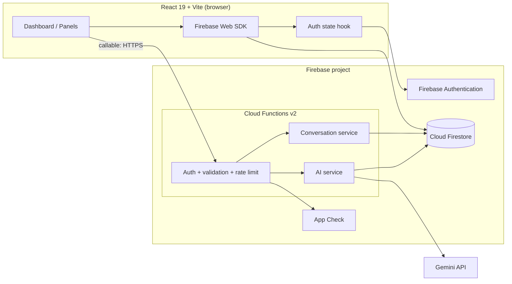

# firebase-ai-starter-kit

**Overview:** Secure Gemini AI on Firebase: Auth, Firestore ownership rules, hardened Cloud Functions, emulator-first tests, CI and guarded deploys.

| Attribute | Value |
| --- | --- |
| Repository | [hamids-ai-automations/firebase-ai-starter-kit](https://github.com/hamids-ai-automations/firebase-ai-starter-kit) |
| Live website | not deployed / not declared |
| Visibility | public |
| Status | active |
| Creation date | 2026-11-21 |
| Last update | 2026-11-21 |
| Last push | 2026-11-21 |
| Default branch | main |
| License | MIT |
| Primary language | TypeScript |
| Stars / Forks / Watchers | 0 / 0 / 0 |
| Issues (open / closed) | 0 / 0 |
| Pull requests (open / merged) | 9 / 0 |
| Releases | 0 |
| Contributors | 1 |
| Size | 570 KB |
| Topics | cloud-functions, firebase, gemini, google-ai, openai-alternative, react, security, starter-kit, typescript, vite |

## Objectives

# Firebase AI Starter Kit

## Features

No explicit feature list found in the README.

## Technical architecture

- **Top-level directories:** .github, apps, docs, firestore, functions, scripts
- **Total files (tracked in default branch):** 109
- **CI workflows:** .github/workflows/ci.yml, .github/workflows/deploy.yml
- **Test files detected:** 10

## Languages and technologies

| Language | Bytes |
| --- | --- |
| TypeScript | 151246 |
| JavaScript | 12472 |
| HTML | 531 |
| CSS | 201 |

**Frameworks / libraries detected:** Firebase, React

**Dependencies:** @eslint/js, eslint, eslint-plugin-react-hooks, eslint-plugin-react-refresh, globals, prettier, typescript-eslint

## Important source files

- `apps/web/package.json`
- `apps/web/tsconfig.json`
- `firebase.json`
- `functions/package.json`
- `functions/tsconfig.json`
- `package.json`

## Installation and setup

No installation instructions found in the README.

## Deployment

No deployment configuration detected.

## Documentation links

- https://wa.me/923167417135
- https://fb-ai-starter-kit.web.app
- https://marvis.web.app/projects/firebase-ai-starter-kit
- https://console.firebase.google.com

## Development status

Active — last push 2026-11-21

## Associated contributions

- Open issues: 0
- Merged pull requests: 0
- Releases: 0

## Related projects

- hamids-ai-automations/ghl-servicepro-theme
- hamids-ai-automations/servicenow-ultimate-mcp
- hamids-ai-automations/shopify-growth-mcp
- hamids-ai-automations/ghl-devops-toolkit
- hamids-ai-automations/nexgen-financial-experts

## Known issues and limitations

No limitations documented in the README.

## Future development opportunities

No roadmap documented in the README.

## README source

Full README: https://github.com/hamids-ai-automations/firebase-ai-starter-kit/blob/main/README.md

```markdown
# Firebase AI Starter Kit

[](https://github.com/hamids-ai-automations/firebase-ai-starter-kit/actions/workflows/ci.yml)
[](LICENSE)
[](package.json)

A production-minded starter kit for building **Gemini AI features on Firebase** — real authentication,
owner-scoped Firestore rules, strict validation, an emulator-first workflow, and a working React demo
instead of a snippet collection.

It ships in two interchangeable deployment modes. The default build targets the **free Spark plan**;
the same endpoints also exist as server-side Cloud Functions for teams that want the key off the client.

| Mode                                  | Gemini calls run                                                 | Billing             | Status                                        |
| ------------------------------------- | ---------------------------------------------------------------- | ------------------- | --------------------------------------------- |
| **Spark mode** (default build)        | In the browser via REST, using the signed-in user's own API key  | None — no Blaze     | **Live:** <https://fb-ai-starter-kit.web.app> |
| **Blaze mode** (`functions/` variant) | Inside Cloud Functions 2nd gen, key held as a server-only secret | Blaze plan required | Reference implementation, deployed on demand  |

- **Live demo (Spark):** <https://fb-ai-starter-kit.web.app>
- **Project page:** <https://marvis.web.app/projects/firebase-ai-starter-kit>
- **Spark deployment guide:** [`docs/FREE_PLAN_DEPLOYMENT.md`](https://github.com/hamids-ai-automations/firebase-ai-starter-kit/blob/main/docs/FREE_PLAN_DEPLOYMENT.md)
- **Documentation:** [`docs/`](https://github.com/hamids-ai-automations/firebase-ai-starter-kit/blob/main/docs/) — architecture, setup, API reference, security, testing, deployment

---

## Table of contents

1. [Project introduction](#1-project-introduction)
2. [Problem statement](#2-problem-statement)
3. [Key features](#3-key-features)
4. [Architecture](#4-architecture)
5. [Technology stack](#5-technology-stack)
6. [Screenshots](#6-screenshots)
7. [Prerequisites](#7-prerequisites)
8. [Installation](#8-installation)
9. [Firebase configuration](#9-firebase-configuration)
10. [Gemini configuration](#10-gemini-configuration)
11. [Environment variables](#11-environment-variables)
12. [Local development](#12-local-development)
13. [Authentication guide](#13-authentication-guide)
14. [Firestore guide](#14-firestore-guide)
15. [Gemini integration guide](#15-gemini-integration-guide)
16. [Cloud Functions guide](#16-cloud-functions-guide)
17. [Security documentation](#17-security-documentation)
18. [Testing](#18-testing)
19. [Deployment](#19-deployment)
20. [Troubleshooting](#20-troubleshooting)
21. [Contributing](#21-contributing)
22. [License](#22-license)
23. [Roadmap](#23-roadmap)
24. [Project links](#24-project-links)

---

## 1. Project introduction

Most "AI + Firebase" samples skip Firestore rules, trust the client to police its own data, and stop
at a single prototype file. This kit is built around the parts that decide whether an AI feature
survives real users: **who may read a document, what happens when the model returns malformed JSON,
where the API key lives, and how any of it is tested before production.**

The kit deliberately implements the same product through two back ends:

- **Spark mode** — the browser calls Gemini REST directly with a key the user supplies in the Setup
  tab. The key lives in `sessionStorage` for that tab only: never committed, never bundled, never
  written to Firestore. This mode needs no billing account, and it is what runs at
  <https://fb-ai-starter-kit.web.app>.
- **Blaze mode** — the same endpoints as Cloud Functions 2nd gen: Zod validation, per-user rate
  limits, server-only `GEMINI_API_KEY`, conversation persistence. Kept in `functions/` as the
  production upgrade path.

Both modes share one contract (`apps/web/src/lib/api.ts` keeps the original callable-shaped function
names), so switching modes is a configuration change, not a rewrite.

## 2. Problem statement

Building an AI feature on Firebase usually raises the same five problems:

| Problem                  | Typical shortcut                                     | What this kit does                                                                          |
| ------------------------ | ---------------------------------------------------- | ------------------------------------------------------------------------------------------- |
| API key exposure         | Key inlined into the production bundle               | Spark mode: user-supplied key kept in `sessionStorage` only. Blaze mode: server-only secret |
| Unbounded cost           | No limits on prompt size, history, or call frequency | Zod length caps, message-history caps, Firestore-backed per-user rate limits                |
| Data leakage             | Shared collection with client-side filtering         | `users/{uid}/**` ownership rules, enforced and unit-tested                                  |
| Unvalidated model output | Raw JSON parsed in the UI                            | Schema-constrained structured output validated before it reaches React                      |
| Untestable setup         | Manual clicking through the console                  | Emulator Suite, mocked model, 51 unit tests, 22 rules tests, 14 end-to-end emulator checks  |

## 3. Key features

**Authentication**

- Email/password sign-up, sign-in, password reset, session persistence, sign-out.
- Profile bootstrap on first login (`ensureUserProfile`) and profile updates with validated preferences.

**Firestore**

- Per-user profile, preferences, conversations, messages, and monthly usage counters.
- Security rules covering read/write separation, ownership, immutability of server-managed fields.

**Gemini**

- Server-side text generation, chat with history, and schema-constrained structured output.
- Mock mode for emulator/CI runs so tests never bill the API.

**Cloud Functions (2nd gen, TypeScript)**

- Nine callable endpoints with shared middleware: auth, App Check awareness, validation, rate
  limiting, structured error mapping, and request logging.

**Security**

- App Check integration points, strict schemas, rate limits, redacted logging, secret scanning
  script, hardened hosting headers, and a documented threat model.

**Developer experience**

- One-command emulator flow, mock AI mode, type-checking, linting, formatting, secret scanning,
  rules tests, emulator smoke test, and CI workflow.

## 4. Architecture



> **Spark mode difference.** In the default build the `Cloud Functions v2` box above is not deployed.
> The browser keeps the same API surface but calls `generativelanguage.googleapis.com/v1beta`
> directly with the user's key, and writes conversation history to Firestore under the same rules.
> The diagram describes Blaze mode; see [`docs/FREE_PLAN_DEPLOYMENT.md`](https://github.com/hamids-ai-automations/firebase-ai-starter-kit/blob/main/docs/FREE_PLAN_DEPLOYMENT.md)
> for the client-side request path.

Request path for an AI call (Blaze mode):

1. The React panel calls a ca
```
