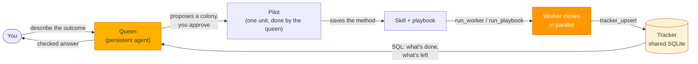

# hive

**Overview:** Multi-Agent Harness for Production AI

| Attribute | Value |
| --- | --- |
| Repository | [hamids-ai-automations/hive](https://github.com/hamids-ai-automations/hive) |
| Live website | not deployed / not declared |
| Visibility | public |
| Status | fork |
| Creation date | 2026-10-28 |
| Last update | 2026-10-28 |
| Last push | 2026-10-28 |
| Default branch | main |
| License | Apache-2.0 |
| Primary language | Python |
| Stars / Forks / Watchers | 0 / 0 / 0 |
| Issues (open / closed) | 0 / 0 |
| Pull requests (open / merged) | 0 / 0 |
| Releases | 0 |
| Contributors | 211 |
| Size | 63478 KB |
| Topics | - |

## Objectives

<p align="center">
  <picture>
    <source media="(prefers-color-scheme: dark)" srcset="docs/assets/readme/banner-dark.webp" />
    
  </picture>
</p>

## Features

No explicit feature list found in the README.

## Technical architecture

- **Top-level directories:** .claude, .github, .hive, core, docs, examples, scripts, templates, tools
- **Total files (tracked in default branch):** 2551
- **CI workflows:** .github/workflows/auto-close-duplicates.yml, .github/workflows/ci.yml, .github/workflows/pr-check-command.yml, .github/workflows/pr-requirements-backfill.yml, .github/workflows/pr-requirements-enforce.yml, .github/workflows/pr-requirements.yml, .github/workflows/release.yml
- **Test files detected:** 480

## Languages and technologies

| Language | Bytes |
| --- | --- |
| Python | 13002035 |
| TypeScript | 2619626 |
| JavaScript | 128404 |
| HTML | 119630 |
| PowerShell | 102523 |
| Shell | 96087 |
| CSS | 95215 |
| Makefile | 2412 |
| Dockerfile | 1554 |

**Frameworks / libraries detected:** none detected from dependency files

**Dependencies:** @types/node, typescript

## Important source files

- `core/framework/server/app.py`
- `core/frontend/package.json`
- `core/frontend/tsconfig.json`
- `core/pyproject.toml`
- `package.json`
- `pyproject.toml`
- `tools/pyproject.toml`
- `tools/src/pyproject.toml`

## Installation and setup

**You'll need** Python 3.11+, Node.js 20+ and git. The quickstart installs `uv` and `ripgrep` if they're missing, and offers to install Node.

**And a model.** The quickstart sets up any of these:

- an API key from Anthropic, OpenAI, Google Gemini, Groq, Cerebras or OpenRouter
- a coding subscription you already pay for: Claude Code, OpenAI Codex, Kimi Code, MiniMax, Z.AI or Antigravity
- Hive LLM
- a local model through Ollama, with no key at all

```bash
git clone https://github.com/aden-hive/hive.git
cd hive
./quickstart.sh          # macOS / Linux
.\quickstart.ps1         # Windows (PowerShell 5.1+)
```

The quickstart creates a single Python environment for the workspace, stores your API key encrypted under `~/.hive`, asks which model to use, builds the dashboard and opens it at `http://127.0.0.1:8787`. Next time, run `hive open` from the repository.

## Deployment

No deployment configuration detected.

## Documentation links

- https://agentskills.io
- https://www.ycombinator.com/companies/aden
- https://discord.com/invite/MXE49hrKDk
- https://x.com/aden_hq
- https://www.linkedin.com/company/teamaden
- https://custom-icon-badges.demolab.com/badge/LinkedIn-0A66C2?logo=linkedin-white&logoColor=fff
- http://127.0.0.1:8787`
- https://docs.litellm.ai/docs/providers
- https://docs.adenhq.com
- http://honeycomb.open-hive.com
- https://jobs.adenhq.com/a8cec478-cdbc-473c-bbd4-f4b7027ec193/applicant
- https://www.star-history.com/?type=date&repos=aden-hive%2Fhive
- https://api.star-history.com/chart?repos=aden-hive/hive&type=date&theme=dark&legend=top-left&sealed_token=vfX1DG8w_KTkonUUtIEjFRLvBopgDzxQpyb8hiYT22sobcDIpvQiMciZghLsDu5hyU3LJs-ZddFjl8eYFx5zRrY-kcMRsfyQ3vAiacsroPoqgRYmZaES3Q
- https://api.star-history.com/chart?repos=aden-hive/hive&type=date&legend=top-left&sealed_token=vfX1DG8w_KTkonUUtIEjFRLvBopgDzxQpyb8hiYT22sobcDIpvQiMciZghLsDu5hyU3LJs-ZddFjl8eYFx5zRrY-kcMRsfyQ3vAiacsroPoqgRYmZaES3Q

## Development status

Fork of another project; see upstream for original authorship.

## Associated contributions

- Open issues: 0
- Merged pull requests: 0
- Releases: 0

## Related projects

- hamids-ai-automations/marvis-streamlit-dashboard
- hamids-ai-automations/github-profile-master-record
- hamids-ai-automations/agentshield-ai
- hamids-ai-automations/seo-intelligence-ai
- hamids-ai-automations/adwaste-intelligence

## Known issues and limitations

No limitations documented in the README.

## Future development opportunities

No roadmap documented in the README.

## README source

Full README: https://github.com/hamids-ai-automations/hive/blob/main/README.md

```markdown
<p align="center">
  <picture>
    <source media="(prefers-color-scheme: dark)" srcset="docs/assets/readme/banner-dark.webp" />
    
  </picture>
</p>

<p align="center">
  <a href="README.md">English</a> |
  <a href="docs/i18n/zh-CN.md">简体中文</a> |
  <a href="docs/i18n/es.md">Español</a> |
  <a href="docs/i18n/hi.md">हिन्दी</a> |
  <a href="docs/i18n/pt.md">Português</a> |
  <a href="docs/i18n/ja.md">日本語</a> |
  <a href="docs/i18n/ru.md">Русский</a> |
  <a href="docs/i18n/ko.md">한국어</a>
</p>

<p align="center">
  <a href="https://github.com/aden-hive/hive/blob/main/LICENSE"></a>
  <a href="https://www.ycombinator.com/companies/aden"></a>
  <a href="https://discord.com/invite/MXE49hrKDk"></a>
  <a href="https://x.com/aden_hq"></a>
  <a href="https://www.linkedin.com/company/teamaden/"></a>
</p>

<h3 align="center">An open-source runtime for colonies of AI agents that do real business work.</h3>

<p align="center">
  Tell a queen agent what you need. She does the first piece herself to learn what the job takes, then hands the rest to as many parallel workers as it needs. Every result lands in a shared tracker you can query, audit and resume from.
</p>

<p align="center">
  <a href="docs/assets/readme/demo.mp4"></a>
  <br />
  <sub>A real run. Only the typing and the waiting are sped up, and the badge says by how much. <a href="docs/assets/readme/demo.mp4">Watch the full run (MP4)</a>.</sub>
</p>

## What you just watched

A growth team preparing a Show HN wants to know how five developer tools' own launches did on Hacker News. Here's what Hive did with that one message:

1. **You hand it to a queen.** Queens are long-lived agents with a role (here, Head of Growth) and their own memory and tools.
2. **She asks the one question that changes the answer:** every launch post, or only each product's original launch? You pick every launch, and she carries on.
3. **She proposes a colony, and you approve it.** Five products means five parallel jobs, so the chat becomes a colony: the queen plus as many worker agents as the work needs.
4. **She does one herself.** She takes PostHog first, works out what counts as a genuine launch post rather than a passing mention, checks the numbers against the Hacker News API, and saves the method as a reusable skill.
5. **She fans out.** A playbook starts one worker per product. Each follows her skill and writes its result to the colony's tracker, a shared SQLite table.
6. **She checks every row before she answers, and fixes one.** Cal.com's worker counted a post from its old name, Calendso, but that post wasn't a Show HN, Launch HN or YC launch. She clears the row, and the chart shows Cal.com as not found rather than zero.

None of this was wired up in advance. There's no workflow graph to draw: the queen shapes the colony as the work unfolds, and a tracker on disk, not a context window, keeps count of what's done and what's left.

## Quick start

**You'll need** Python 3.11+, Node.js 20+ and git. The quickstart installs `uv` and `ripgrep` if they're missing, and offers to install Node.

**And a model.** The quickstart sets up any of these:

- an API key from Anthropic, OpenAI, Google Gemini, Groq, Cerebras or OpenRouter
- a coding subscription you already pay for: Claude Code, OpenAI Codex, Kimi Code, MiniMax, Z.AI or Antigravity
- Hive LLM
- a local model through Ollama, with no key at all

```bash
git clone https://github.com/aden-hive/hive.git
cd hive
./quickstart.sh          # macOS / Linux
.\quickstart.ps1         # Windows (PowerShell 5.1+)
```

The quickstart creates a single Python environment for the workspace, stores your API key encrypted under `~/.hive`, asks which model to use, builds the dashboard and opens it at `http://127.0.0.1:8787`. Next time, run `hive open` from the repository.

> [!NOTE]
> This repository is a `uv` workspace: `pip install -e .` at its root installs a placeholder that won't run, so use the quickstart. Without the repository, `pip install "aden-hive[tools]"` installs Hive from PyPI; then run `hive open`. To add an optional package (a chat-app channel, for example), see [Optional packages](https://github.com/hamids-ai-automations/hive/blob/main/docs/optional-packages.md). To build your own project on Hive's agent loop and models, depend on `aden-hive`: see [Building on Hive](https://github.com/hamids-ai-automations/hive/blob/main/docs/building-on-hive.md).

**Then** type a task on the home screen and choose the queen to give it to, or open the **Prompt Library** and send a ready-made prompt straight to the queen it was written for.

## How it works



Hive has **one execution primitive**: the agent loop. The queen is one, and every worker is a clone of it with its own task, a narrower set of tools and a strict budget. Orchestration is a tool call, not a compiled graph:

- **`run_worker`** fans tasks out and returns at once, so the queen keeps talking to you while workers run. Four run at a time by default; the rest wait their turn. Each worker's report arrives in the queen's conversation as a new turn.
- **The tracker** is the colony's shared state. The queen defines the table and which columns workers may write, workers upsert one row per unit of work, and the queen checks progress with SQL. It's a file on disk: `~/.hive/colonies/<name>/tracker/tracker.db`.
- **`run_playbook`** runs a proven method over every row, with retries and backoff, rate-limited lanes, and a dead-letter list for rows that keep failing. "What's left" is always a fresh query of the tracker, so re-running a playbook picks up where it stopped.

The **[architecture overview](https://github.com/hamids-ai-automations/hive/blob/main/docs/architecture/README.md)** goes deeper: the loop, the tool surface, memory, human oversight, and how state survives a crash.

<table>
  <tr>
    <td width="50%"><br /><sub><b>Home.</b> Your queens and their colonies on one map. Describe a task and choose who takes it.</sub></td>
    <td width="50%"><br /><sub><b>Workers.</b> One per unit of work, each with its own task and budget, all reporting to the queen.</sub></td>
  </tr>
  <tr>
    <td width="50%"><br /><sub><b>Tracker.</b> Results land in a shared table as workers fin
```
