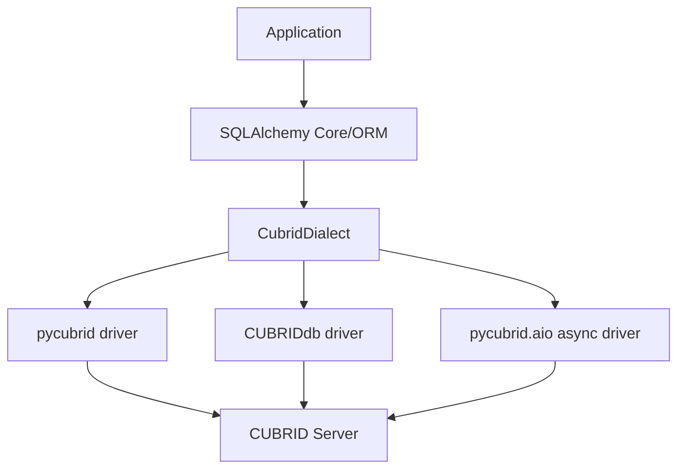
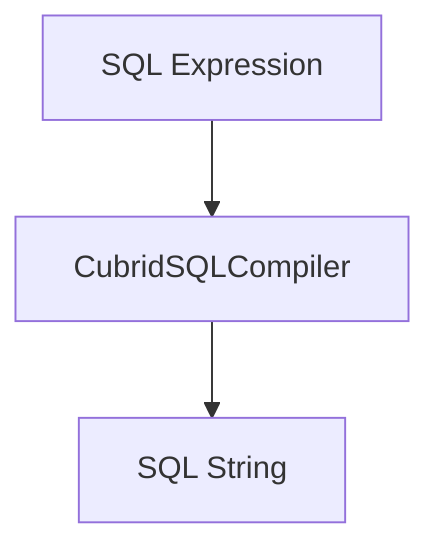

# sqlalchemy-cubrid

**Overview:** SQLAlchemy 2.0–2.2 dialect for CUBRID with Alembic, async, and ORM support

| Attribute | Value |
| --- | --- |
| Repository | [hamids-ai-automations/sqlalchemy-cubrid](https://github.com/hamids-ai-automations/sqlalchemy-cubrid) |
| Live website | https://cubrid-lab.github.io/sqlalchemy-cubrid/ |
| Visibility | public |
| Status | fork |
| Creation date | 2026-10-29 |
| Last update | 2026-10-29 |
| Last push | 2026-10-29 |
| Default branch | main |
| License | MIT |
| Primary language | Python |
| Stars / Forks / Watchers | 0 / 0 / 0 |
| Issues (open / closed) | 0 / 0 |
| Pull requests (open / merged) | 0 / 0 |
| Releases | 0 |
| Contributors | 23 |
| Size | 5031 KB |
| Topics | - |

## Objectives

<!-- CUBRID-LAB-ICON:START -->
<p align="center">
  <a href="https://github.com/cubrid-lab/brand"></a>
</p>
<!-- CUBRID-LAB-ICON:END -->

## Features

- Type mapping for SQLAlchemy standard and CUBRID-specific types — numeric, string, date/time, bit, LOB, collection, and JSON types
- SQL compilation -- SELECT, JOIN, CAST, LIMIT/OFFSET, subqueries, CTEs, window functions
- DML extensions -- `ON DUPLICATE KEY UPDATE`, `MERGE`, `REPLACE INTO`, `FOR UPDATE`, `TRUNCATE`
- DDL support -- `COMMENT`, `IF NOT EXISTS` / `IF EXISTS`, `AUTO_INCREMENT`
- Schema reflection -- tables, views, columns, PKs, FKs, indexes, unique constraints, comments
- Alembic migrations via `CubridImpl` (registered automatically when the dialect loads)
- Three CUBRID MVCC isolation levels — `READ COMMITTED` (default), `REPEATABLE READ`, `SERIALIZABLE`
- Async support — `create_async_engine("cubrid+aiopycubrid://...")` via pycubrid.aio

## Technical architecture

- **Top-level directories:** .github, agent-evals, benchmarks, demos, docs, samples, scripts, sqlalchemy_cubrid, test
- **Total files (tracked in default branch):** 503
- **CI workflows:** .github/workflows/agent-review.yml, .github/workflows/badge-sync.yml, .github/workflows/ci.yml, .github/workflows/codeql.yml, .github/workflows/dependabot-auto-merge.yml, .github/workflows/docs-sync.yml, .github/workflows/docs.yml, .github/workflows/integration-full.yml, .github/workflows/issue-triage.yml, .github/workflows/labels.yml, .github/workflows/maintenance.yml, .github/workflows/pr-title.yml, .github/workflows/publish-pypi.yml, .github/workflows/python-canary.yml, .github/workflows/release-please.yml, .github/workflows/sbom.yml, .github/workflows/security.yml, .github/workflows/stale.yml, .github/workflows/upstream-canary.yml
- **Test files detected:** 121

## Languages and technologies

| Language | Bytes |
| --- | --- |
| Python | 2515812 |
| Makefile | 13325 |
| Shell | 10533 |

**Frameworks / libraries detected:** SQLAlchemy, pytest

**Dependencies:** none detected

## Important source files

- `.github/docs-requirements/requirements.txt`
- `docker-compose.yml`
- `pyproject.toml`

## Installation and setup

```bash
pip install sqlalchemy-cubrid
```

With the pure Python driver (sync and async):

```bash
pip install "sqlalchemy-cubrid[pycubrid]"
```

The `[pycubrid]` extra supports both `cubrid+pycubrid://` and
`cubrid+aiopycubrid://`. It includes SQLAlchemy's `asyncio` extra (`greenlet`);
`greenlet` may need build tools if a compatible wheel is unavailable.

With Alembic support:

```bash

## Deployment

Firebase/other hosting declared via homepage field: https://cubrid-lab.github.io/sqlalchemy-cubrid/

## Documentation links

- https://www.python.org
- https://cubrid-lab.github.io/sqlalchemy-cubrid
- https://raw.githubusercontent.com/cubrid-lab/brand/e55990a6a0b2c3b0d133985951d41e42b62a8588/dist/icons/sqlalchemy-cubrid.svg
- https://pypi.org/project/sqlalchemy-cubrid
- https://peps.python.org/pep-0619/#310-lifespan

## Development status

Fork of another project; see upstream for original authorship.

## Associated contributions

- Open issues: 0
- Merged pull requests: 0
- Releases: 0

## Related projects

- hamids-ai-automations/agentshield-ai
- hamids-ai-automations/seo-intelligence-ai
- hamids-ai-automations/github-profile-master-record
- hamids-ai-automations/adwaste-intelligence
- hamids-ai-automations/leadflow-sentinel

## Known issues and limitations

> This project is part of [CUBRID Lab](https://github.com/cubrid-lab), an independent open-source initiative for CUBRID developer tooling, and is not affiliated with, sponsored by, or endorsed by CUBRID Corporation or the official CUBRID project.

## Future development opportunities

See [`ROADMAP.md`](https://github.com/hamids-ai-automations/sqlalchemy-cubrid/blob/main/ROADMAP.md) for this project's direction and next milestones.

For the ecosystem-wide view, see the [CUBRID Labs Ecosystem Roadmap](https://github.com/cubrid-lab/.github/blob/main/ROADMAP.md).

## README source

Full README: https://github.com/hamids-ai-automations/sqlalchemy-cubrid/blob/main/README.md

```markdown
<!-- CUBRID-LAB-ICON:START -->
<p align="center">
  <a href="https://github.com/cubrid-lab/brand"></a>
</p>
<!-- CUBRID-LAB-ICON:END -->

# sqlalchemy-cubrid

**SQLAlchemy 2.0–2.1 dialect for the CUBRID database** — Python ORM, schema reflection, Alembic migrations, and type mapping for SQLAlchemy and CUBRID-specific types.

[🇰🇷 한국어](https://github.com/hamids-ai-automations/sqlalchemy-cubrid/blob/main/docs/README.ko.md) · [🇺🇸 English](https://github.com/hamids-ai-automations/sqlalchemy-cubrid/blob/main/README.md) · [🇨🇳 中文](https://github.com/hamids-ai-automations/sqlalchemy-cubrid/blob/main/docs/README.zh.md) · [🇮🇳 हिन्दी](https://github.com/hamids-ai-automations/sqlalchemy-cubrid/blob/main/docs/README.hi.md) · [🇩🇪 Deutsch](https://github.com/hamids-ai-automations/sqlalchemy-cubrid/blob/main/docs/README.de.md) · [🇷🇺 Русский](https://github.com/hamids-ai-automations/sqlalchemy-cubrid/blob/main/docs/README.ru.md)

<!-- BADGES:START -->
[](https://pypi.org/project/sqlalchemy-cubrid)
[](https://www.python.org)
[](https://github.com/cubrid-lab/sqlalchemy-cubrid/actions/workflows/ci.yml)
[](https://github.com/cubrid-lab/sqlalchemy-cubrid/actions/workflows/integration-full.yml)
[](https://github.com/cubrid-lab/sqlalchemy-cubrid/blob/main/LICENSE)
[](https://github.com/cubrid-lab/sqlalchemy-cubrid)
[](https://cubrid-lab.github.io/sqlalchemy-cubrid/)
<!-- BADGES:END -->

---

> **Status: Production/Stable** — `sqlalchemy-cubrid` is a maintained SQLAlchemy dialect for CUBRID supporting SQLAlchemy 2.0–2.1 and CUBRID 10.2–11.4.
> **Note:** Versions prior to 1.0.0 used inconsistent numbering (0.x, 2.x). The canonical version history starts at 1.0.0.

## Start here

sqlalchemy-cubrid lets SQLAlchemy work with a CUBRID database. CUBRID itself is
a separate database server that must already be running; installing these
packages does not install CUBRID or create a database. New to CUBRID or to
SQLAlchemy? Follow [Your First SQLAlchemy Connection to CUBRID](https://github.com/hamids-ai-automations/sqlalchemy-cubrid/blob/main/docs/QUICKSTART.md):
it shows what to prepare when you already have a database, how to start a
disposable local one with Docker, and takes you on the recommended
`sqlalchemy-cubrid[pycubrid]` path to a first query and a first saved row. The
rest of this page is reference material for after that first connection works.

## Why sqlalchemy-cubrid?

CUBRID is a high-performance open-source relational database, widely adopted in
Korean public-sector and enterprise applications. Until now, there was no
actively maintained SQLAlchemy dialect that supports the modern 2.0–2.1 API.

**sqlalchemy-cubrid** bridges that gap:

- Full SQLAlchemy 2.0–2.1 dialect with **statement caching** and **PEP 561 typing**
- **Extensive offline test suite** — no database required to run it; CI enforces a minimum 95% line-coverage gate (`--cov-fail-under=95` in the `offline-tests` job, [CI badge above](https://github.com/cubrid-lab/sqlalchemy-cubrid/actions/workflows/ci.yml))
- **Concurrency stress tests** — `QueuePool` sync threaded + asyncio.gather workloads validated against live CUBRID
- **SQLAlchemy 2.1-ready compat shim** — private API access wrapped in `_compat.py`; dependency cap `>=2.0,<2.2` covering SA 2.0 and 2.1
- Tested against **4 CUBRID versions** (10.2, 11.0, 11.2, 11.4) across **Python 3.11 -- 3.15**
- CUBRID-specific DML constructs: `ON DUPLICATE KEY UPDATE`, `MERGE`, `REPLACE INTO`
- Alembic migration support out of the box
- **Three driver options** — pure Python (`cubrid+pycubrid://`, recommended), async pure Python (`cubrid+aiopycubrid://`), or the CUBRIDdb C-extension driver (`cubrid://` / `cubrid+cubriddb://`)

## Support Status

- **Status**: Production/Stable [](https://pypi.org/project/sqlalchemy-cubrid)
- Supported matrix: SQLAlchemy `>=2.0,<2.2`, CUBRID `10.2`, `11.0`, `11.2`, `11.4`, Python `3.11`–`3.15`
- Ordinary PRs run the full offline suite with the 95% coverage floor on one Ubuntu/Python 3.12 lane; high-risk changes add Python 3.14/CUBRID 11.4 live integration. Main/changed-weekly runs add Python 3.11/CUBRID 10.2 and run the offline suite on the oldest and newest supported Python (3.11, 3.15). The full supported integration matrix remains manual and release-gated. See [CI execution policy](https://github.com/hamids-ai-automations/sqlalchemy-cubrid/blob/main/docs/CI_POLICY.md).
- An advisory SQLAlchemy pre-release canary logs its resolved version; a passing run alone does not establish 2.2 beta compatibility (see #778)
- See [Known Limitations](#known-limitations) for behavior boundaries and unsupported features

## Architecture



See [full communication architecture](https://github.com/hamids-ai-automations/sqlalchemy-cubrid/blob/main/docs/ARCHITECTURE.md#end-to-end-communication-architecture) for the Broker, CAS and CCI path.



## Requirements

**Python 3.10 support retirement:** Python 3.10 reached upstream end of life on
2026-10-01 ([PEP 619](https://peps.python.org/pep-0619/#310-lifespan)).
The 1.8.x and 1.9.x lines support Python 3.10; 1.9.0 carried the advance notice.
From 1.10.0 the package requires Python 3.11 or newer, so `pip` on Python 3.10
keeps installing 1.9.x. Upgrade your interpreter, recreate your virtual
environment and validate your application before upgrading.

- Python 3.11 or later
- SQLAlchemy 2.0 – 2.1
- [pycubrid](https://github.com/cubrid-lab/pycubrid) (pure Python, recommended) **or** the official CUBRIDdb C extension built from [cubrid-python](https://github.com/CUBRID/cubrid-python) v11.3.0.51 or later

## Installation

```bash
pip install sqlalchemy-cubrid
```

With the pure Python driver (sync and async):

```bash
pip install "sqlalchemy-cubrid[pycubrid]"
```

The `[pycubrid]` extra supports both `cubrid+pycubrid://` and
`cubrid+aiopycubrid://`. It includes SQLAlchemy's `asyncio` extra (`greenlet`);
`greenlet` may need build tools if a compatible wheel is unavailable.

With Alembic support:

```bash
pip install "sqlalchemy-cubrid[alembic]"
```

With the CUBRIDdb C-extension driver (the bare `cubrid://` URL), build
CUBRIDdb from [cubrid-python](https://github.com/CUBRID/cubrid-python) v11.3.0.51 or
later; see [Driver Compatibility](https://github.com/hamids-ai-automations/sqlalchemy-cubrid/blob/main/docs/DRIVER_COMPAT.md#building-cubriddb-from-source).

> **The `[cubrid]` and `[cubriddb]` extras are deprecated.** They install the
> `CUBRID-Python` package from PyPI, whose newest release is 9.3.x (2015). That release is
> untested with this dialect: it returns `BIGINT` as `str` and fails parts of the
> integration suite. The dialect warns (`SAWarning`) at the first connection when it
> finds a CUBRIDdb older than 11.3. For new projects, u
```
