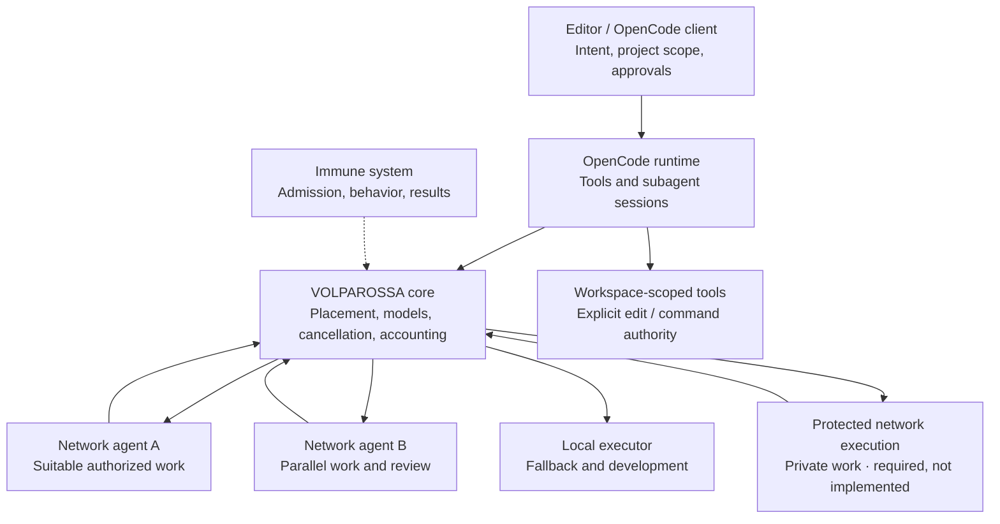

# volparossa-code

**Overview:** Open-source coding assistant integrating OpenCode with VOLPAROSSA's Decentralized Intelligent Cooperative Network (DICN). Designed to read, edit and test code through cooperating agents and shared intelligence. Editor integrations start with VS Code and VSCodium. Under active development.

| Attribute | Value |
| --- | --- |
| Repository | [hamids-ai-automations/volparossa-code](https://github.com/hamids-ai-automations/volparossa-code) |
| Live website | https://volparossa.org/volparossa-code/ |
| Visibility | public |
| Status | fork |
| Creation date | 2026-10-31 |
| Last update | 2026-10-31 |
| Last push | 2026-10-31 |
| Default branch | main |
| License | GPL-3.0 |
| Primary language | JavaScript |
| Stars / Forks / Watchers | 0 / 0 / 0 |
| Issues (open / closed) | 0 / 0 |
| Pull requests (open / merged) | 0 / 0 |
| Releases | 0 |
| Contributors | 2 |
| Size | 4640 KB |
| Topics | - |

## Objectives


## Features

No explicit feature list found in the README.

## Technical architecture

- **Top-level directories:** .github, docs, patches, scripts, src, tests, third_party
- **Total files (tracked in default branch):** 123
- **CI workflows:** .github/workflows/opencode-inference.yml, .github/workflows/opencode-public-code.yml, .github/workflows/source-checks.yml
- **Test files detected:** 49

## Languages and technologies

| Language | Bytes |
| --- | --- |
| JavaScript | 731655 |
| Python | 464256 |
| Shell | 2713 |

**Frameworks / libraries detected:** none detected from dependency files

**Dependencies:** none detected

## Important source files

- `package.json`

## Installation and setup

No installation instructions found in the README.

## Deployment

Firebase/other hosting declared via homepage field: https://volparossa.org/volparossa-code/

## Documentation links

- https://volparossa.org/volparossa-code

## Development status

Fork of another project; see upstream for original authorship.

## Associated contributions

- Open issues: 0
- Merged pull requests: 0
- Releases: 0

## Related projects

- hamids-ai-automations/restock-radar
- hamids-ai-automations/pinvault-pinterest-downloader
- hamids-ai-automations/dayjs

## Known issues and limitations

No limitations documented in the README.

## Future development opportunities

No roadmap documented in the README.

## README source

Full README: https://github.com/hamids-ai-automations/volparossa-code/blob/main/README.md

```markdown


# VOLPAROSSA Code

**Give a coding task a team, without making one device the limit.**

Reading an unfamiliar project, proposing a change and checking it belong in one
workflow. VOLPAROSSA Code connects the open-source **OpenCode** coding runtime
to the [VOLPAROSSA core](https://github.com/VOLPAROSSA/volparossa), with explicit
workspace permissions and reviewable edits. The goal is to share suitable work
and combine agent results across the network, including protected private work.

A bounded [read/edit/test task](https://github.com/hamids-ai-automations/volparossa-code/blob/main/docs/OPENCODE.md#explicit-native-cpu-candidate)
already passes with a real local model on a public fixture, taking about 37 minutes
on the disposable CPU runner. Confidential peer coding remains unfinished.
Contribute to the executable loop, editor integration or measured coding quality
to help move that larger goal beyond a demonstration.

OpenCode replaces the earlier Codex CLI/app-server foundation. Suitable upstream
apps, clients and editor integrations can share the same core connection. The
first integration is a development extension for VS Code/VSCodium on Linux;
cross-platform applications and packaging are not yet complete.

This README describes the OpenCode development integration, not a completed
coding assistant. Original integration code is GPL-3.0-only; upstream licenses
and notices remain intact. This is not an OpenAI-backed service or a copy of
its proprietary IDE extension.

## One coordinator, multiple cooperating agents



This is the **target architecture**, not a claim that every arrow works today.
Network cooperation and collective improvement are the default design, including
private projects. Core owns peer scheduling; OpenCode's local subagents do not
themselves provide a decentralized network or confidential remote execution.

Privacy belongs inside cooperation. Private work must also be able to use suitable
network executors without exposing source or tool data to their operators. That
protected execution is **not implemented by the current local executor**: TLS,
task fragmentation and peer signatures alone do not hide inputs from an ordinary
executing host. Explicitly public task sharing is a separate capability, not proof
of private distributed coding. Code, prompts, tool output and history are not
automatically public cache or training data. A local-only assistant does not
fulfill the goal of the shared VOLPAROSSA brain.

## Current executable integration

**VOLPAROSSA: Run OpenCode Task (Development)** selects the new OpenCode launcher,
not Codex. It joins these implemented components:

- Pinned OpenCode **v1.18.34**, authenticated HTTP sessions and SSE events.
- A Chat Completions provider translating text and function-tool history into
  the core's typed conversation interface.
- One-shot command/edit approvals, correlated root and child sessions,
  cancellation, session deletion and owned-process cleanup.
- An explicit Linux launcher with a selected writable project, temporary state,
  no inherited account credentials and no external network interface.

**Runtime and adapter proof:** the pinned OpenCode source builds and the actual runtime
completes a tool loop through the production launcher and adapters: one approved
command changes a disposable file, its tool result returns to the core interface,
and the session shuts down cleanly. A second native trial invokes the cooperative
tool, preserves complete and incomplete core results, and confirms that only the
enrolled public snapshot crosses the bridge. Both trials use **synthetic core/model
replies**, not real inference or peer execution. Focused checks additionally cover
adapter, editor and lifecycle behavior.

**Real model-driven coding:** the [Qwen4B native CPU trial](https://github.com/VOLPAROSSA/volparossa-code/actions/runs/38824828727)
passes the bounded coding task **and its complete lifecycle**. Actual OpenCode
and core inference produce two reads, an approved edit, an approved test and
a final response. The original tests stay unchanged and an independent check
passes. Task-resource measurements, unchanged inputs, clean core shutdown and
guest/VM cleanup are verified.

The task takes about 37 minutes on the disposable CPU runner; this is a working
development slice, not competitive performance or general coding-quality proof.
The core processes the complete prompt in adaptive blocks while retaining the
model, permissions, resource budgets and ten-second owner-control guard. Earlier
failed trials remain documented. This path pins the exact tested core candidate
`7d0f9f0b`, rather than selecting whichever core happens to be on `main`.
Native editor UI operation, protected peer execution and the complete
immune-policy path remain open. See the
[native CPU evidence](https://github.com/hamids-ai-automations/volparossa-code/blob/main/docs/OPENCODE.md#explicit-native-cpu-candidate).

**Real public peer proof:** a separate owner command successfully obtained a
small single-file replacement from a real Qwen0.6B worker on another peer.
After explicit edit and check approvals, the unchanged original tests and an
independent check passed. The original
[disposable-network trial](https://github.com/VOLPAROSSA/volparossa-code/actions/runs/37221727043)
also passed its discovery/task route checks and complete cleanup. This proves
that bounded public operation, not a native OpenCode planning loop, general
coding quality or confidential execution of private source on other devices.

The available conversation executor is still **private and local**. Its scope is
shown honestly; the adapter does not disguise it as network compute or export
private input through the public peer interface.

**VOLPAROSSA: Run OpenCode Task with Enrolled Public Work** additionally connects
one explicitly reviewed public question and selected excerpt to the core's
cooperative task interface. The model can invoke this task once; it cannot append
private files or history to it. A limited owner-side proxy keeps the raw public
core socket outside the coding sandbox. Core owns peer placement, execution and
cancellation; original task results and incomplete-answer flags are retained.
This interface requires a core that implements the matching cooperative-compute
contract. Complete joined answers through the real OpenCode tool remain unproved.

**Run OpenCode Task with Enrolled Public Source** instead enrolls the complete
saved source file for a peer-generated code replacement. The native agent can
request that original proposal through the same single-use tool, then propose
local changes and run separately approved checks. This connects the code-purpose
service to the agent loop; a complete real-model cooperative coding run remains
to be proved. See [public source tasks](https://github.com/hamids-ai-automations/volparossa-code/blob/main/docs/OPENCODE.md#explicit-public-single-file-proposals-candidate).

This public-only development step is **not** the intended limit of cooperati
```
